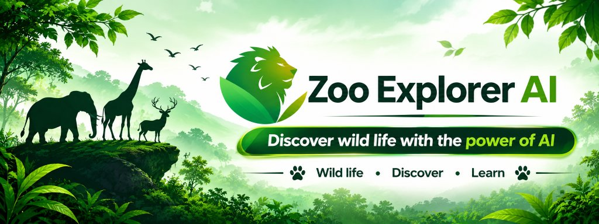
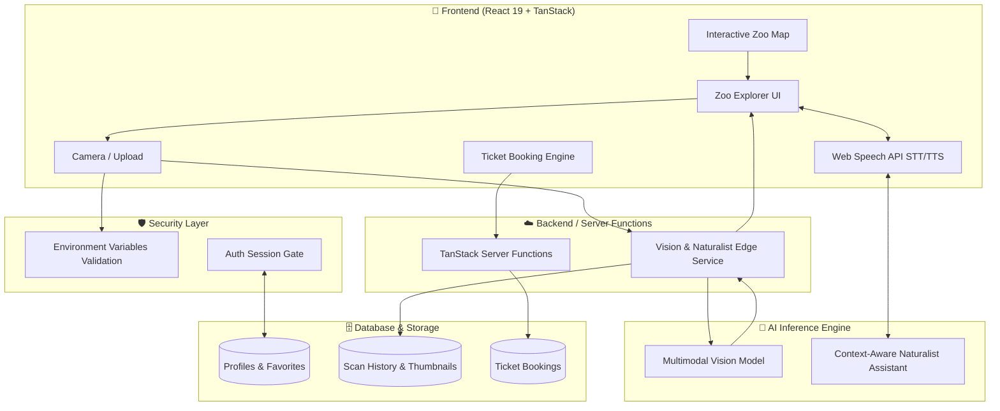

<p align="center">
  
</p>

<h1 align="center">Zoo Explorer AI</h1>
<h3 align="center">Discover Wildlife with AI</h3>

<p align="center">
  <strong>A modern, mobile-first zoo companion web application powered by AI animal vision recognition, voice-assisted interactive naturalists, smart ticketing, and interactive zone mapping.</strong>
</p>

<p align="center">
  
  
  
  
  
  
</p>

<p align="center">
  <a href="https://zooexplorer-ai.lovable.app" target="_blank">
    
  </a>
</p>

<p align="center">
  🔗 <strong>Live App URL:</strong> <a href="https://zooexplorer-ai.lovable.app" target="_blank">https://zooexplorer-ai.lovable.app</a>
</p>

---

## 📑 Table of Contents

- [Overview](#-overview)
- [System Architecture & Workflow](#-system-architecture--workflow)
- [Core Features](#-core-features)
- [Tech Stack](#-tech-stack)
- [Project Structure](#-project-structure)
- [Getting Started](#-getting-started)
  - [Prerequisites](#prerequisites)
  - [Installation](#1-clone--install-dependencies)
  - [Environment Configuration](#2-environment-setup)
  - [Backend Setup (Bring Your Own Backend)](#3-backend-setup)
  - [AI Setup (Bring Your Own AI)](#4-ai-vision--naturalist-assistant-setup-bring-your-own-ai)
  - [Running the App](#5-run-development-server)
  - [Production Build](#6-build-for-production)
- [Security & Privacy](#-security--privacy)
- [License](#-license)

---

## 🌿 Overview

> 🌐 **Try the Live Application:** [https://zooexplorer-ai.lovable.app](https://zooexplorer-ai.lovable.app)

**Zoo Explorer AI** transforms the traditional zoo experience into an engaging, educational, and tech-driven adventure. Designed from the ground up with a nature-inspired design language and high-performance full-stack React 19 architecture, it empowers zoo visitors to:

1. **Snap or Upload** pictures of animals to instantly identify species, diets, conservation statuses, and fun trivia.
2. **Talk to a Naturalist AI** in real-time with full two-way voice recognition and speech synthesis.
3. **Navigate the Zoo Grounds** with an interactive coordinate-mapped aerial map.
4. **Book Tickets Online** with instant price calculation and validation.
5. **Collect Wildlife Moments** into favorites and personal scan journals.

---

## 📊 System Architecture & Workflow



---

## ✨ Core Features

| Feature | Description | Highlight |
| :--- | :--- | :--- |
| 📷 **AI Vision Recognition** | Identify wild animals, birds, reptiles, and aquatic species instantly from camera capture or image uploads. | High-precision species classification & conservation metadata |
| 🎙️ **Voice Naturalist AI** | Interactive two-way voice assistant (Speech-to-Text & Text-to-Speech) to ask natural questions about any animal. | Hands-free audio learning experience |
| 🗺️ **Interactive Zone Map** | Aerial zoo map with interactive pins navigating straight to curated zones (Wild Zone, Aviary, Aquarium, etc.). | Zone-based discoverability |
| 🎟️ **Ticketing System** | Full booking workflow supporting Adult, Student, Child, Senior, and Family packages with date selection. | Real-time pricing & ticket records |
| ❤️ **Favorites & Scan History** | Save favorite creatures and review past scans with lightweight auto-compressed thumbnails. | Offline-ready local & cloud sync |
| 📱 **PWA & Mobile First** | Installable Progressive Web App with offline caching, smooth mobile gestures, and responsive layouts. | Works seamlessly on phones & tablets |

---

## 🛠️ Tech Stack

- **Core Framework**: [React 19](https://react.dev/) + [TanStack Start](https://tanstack.com/start) + [TanStack Router](https://tanstack.com/router)
- **Bundler & Tooling**: [Vite 7](https://vitejs.dev/) + TypeScript
- **Styling**: [Tailwind CSS v4](https://tailwindcss.com/) with native OKLCH theme tokens and CSS variables
- **Components & Primitives**: [Radix UI](https://www.radix-ui.com/) accessible primitives + Lucide Icons
- **Voice Capabilities**: Web Speech API (SpeechRecognition + SpeechSynthesis)
- **Notifications**: Sonner Toasts
- **Data Layer**: Clean decoupled architecture ready for Supabase or any custom REST/GraphQL backend

---

## 📁 Project Structure

```text
zoo-explorer-ai/
├── public/                     # Static assets, PWA icons, manifest & banners
│   ├── banner.jpg              # Full-size header banner
│   ├── manifest.webmanifest    # PWA configuration
│   └── ...
├── src/
│   ├── assets/                 # Wildlife imagery, category visuals, and app branding
│   ├── components/             # Reusable UI widgets & feature components
│   │   ├── ui/                 # Radix UI design system primitives (Button, Card, Dialog...)
│   │   ├── AiChatPanel.tsx     # Voice-enabled Naturalist Q&A conversation panel
│   │   ├── ProfileMenu.tsx     # Visitor account & quick navigation menu
│   │   ├── ScanFooter.tsx      # Sticky mobile navigation bar (Capture, Scan, Upload)
│   │   └── SplashScreen.tsx    # Branded introductory splash screen
│   ├── hooks/                  # Custom React hooks (useAuth, use-mobile)
│   ├── integrations/           # Backend adapters (Supabase client & middleware)
│   ├── lib/                    # Domain logic & utility libraries
│   │   ├── animals.ts          # Static animal categories & facts catalog
│   │   ├── recognize.ts        # AI recognition client and prompt contracts
│   │   ├── ticketPricing.ts    # Pricing matrix & calculation algorithms
│   │   └── voice.ts            # Web Speech API helpers (STT & TTS)
│   ├── routes/                 # File-based routes (TanStack Router)
│   │   ├── __root.tsx          # App shell, navigation header, and providers
│   │   ├── index.tsx           # Home page with hero, categories & quick cards
│   │   ├── scan.tsx            # AI scanner, results overview & Q&A interface
│   │   ├── animal.$slug.tsx    # Comprehensive animal profile & deeper insights
│   │   ├── category.$slug.tsx  # Categorized animal gallery
│   │   ├── map.tsx             # Interactive zoo grounds map with zone pins
│   │   ├── tickets.tsx         # Booking form & pass confirmation history
│   │   ├── favorites.tsx       # Bookmarked animals list
│   │   └── history.tsx         # Recent scan journal
│   ├── server/                 # Server functions (tickets.functions.ts)
│   └── styles.css              # Tailwind v4 styles, custom gradients & tokens
├── .env.example                # Template for environment configuration
├── package.json                # Project dependencies & scripts
├── tsconfig.json               # TypeScript compiler rules
└── vite.config.ts              # Vite build configuration
```

---

## 🚀 Getting Started

Follow these steps to set up and run Zoo Explorer AI locally.

### Prerequisites

- [Node.js](https://nodejs.org/) (version **18.x** or higher, recommended **20+**)
- `npm`, `pnpm`, or `bun` package manager

### 1. Clone & Install Dependencies

```bash
git clone https://github.com/dipzz0/Zoo-Explorer-AI.git
cd Zoo-Explorer-AI
npm install
```

### 2. Environment Setup

Create a `.env` file in the root directory by copying the sample template:

```bash
cp .env.example .env
```

Open `.env` and fill in your backend credentials:

```env
# Backend / Database Configuration (e.g. Supabase)
VITE_SUPABASE_URL="https://your-project.supabase.co"
VITE_SUPABASE_PUBLISHABLE_KEY="your-anon-publishable-key"
SUPABASE_URL="https://your-project.supabase.co"
SUPABASE_PUBLISHABLE_KEY="your-anon-publishable-key"
```

### 3. Backend Setup

This frontend is designed to be completely **backend-agnostic**. You can connect it to your own **Supabase** instance or custom backend service:

<details>
<summary><strong>Click to view required database tables schema (SQL)</strong></summary>

```sql
-- Profiles
create table public.profiles (
  id uuid primary key references auth.users(id) on delete cascade,
  name text not null,
  email text,
  created_at timestamptz not null default now()
);

-- User Favorites
create table public.favorites (
  id uuid primary key default gen_random_uuid(),
  user_id uuid not null references auth.users(id) on delete cascade,
  animal_name text not null,
  category text,
  image_url text,
  created_at timestamptz not null default now(),
  unique(user_id, animal_name)
);

-- Scan History
create table public.scan_history (
  id uuid primary key default gen_random_uuid(),
  user_id uuid not null references auth.users(id) on delete cascade,
  name text not null,
  kind text,
  summary text,
  image_data text,
  created_at timestamptz not null default now()
);

-- Ticket Bookings
create table public.tickets (
  id uuid primary key default gen_random_uuid(),
  user_id uuid not null references auth.users(id) on delete cascade,
  visit_date date not null,
  visitors integer not null check (visitors > 0),
  total_amount numeric not null,
  status text not null default 'confirmed',
  created_at timestamptz not null default now()
);
```

</details>

### 4. AI Vision & Naturalist Assistant Setup (Bring Your Own AI)

The frontend communicates with an AI backend via [`src/lib/recognize.ts`](src/lib/recognize.ts). Because no private API keys are bundled with this repository, you can attach any multimodal AI provider of your choice (**Google Gemini**, **OpenAI GPT-4o**, **Anthropic Claude**, or **Ollama**).

#### How the AI Contract Works:

The app makes two types of calls:

1. **Wildlife Image Recognition**:
   - **Payload**: `{ imageBase64: "data:image/jpeg;base64,...", mode: "basic" | "extended" }`
   - **Expected Response**:
     ```json
     {
       "name": "African Lion",
       "kind": "animal",
       "species": "Panthera leo",
       "habitat": "African savannas and grasslands",
       "diet": "Carnivore — large mammals",
       "summary": "The lion is a large cat of the genus Panthera, native to Africa and India.",
       "facts": [
         "Pride groups are typically led by females.",
         "A lion's roar can be heard up to 8 km away."
       ],
       "conservation": "Vulnerable",
       "confidence": "high"
     }
     ```

2. **Naturalist Interactive Q&A Chat**:
   - **Payload**: `{ action: "chat", subject: { name, kind, species }, history: [...], question: "Where do they sleep?" }`
   - **Expected Response**: `{ "reply": "Lions typically sleep for up to 20 hours a day in shady grasslands..." }`

---

#### ⚡ Quick Setup with Supabase Edge Functions + Google Gemini / OpenAI:

If you are using Supabase, you can set up this function in under 3 minutes:

1. **Initialize & Create Edge Function**:
   ```bash
   supabase functions new recognize
   ```

2. **Set your AI API Secret**:
   ```bash
   # If using Google Gemini:
   supabase secrets set GEMINI_API_KEY="your-google-gemini-api-key"

   # Or if using OpenAI:
   supabase secrets set OPENAI_API_KEY="your-openai-api-key"
   ```

3. **Deploy the Function**:
   ```bash
   supabase functions deploy recognize --no-verify-jwt
   ```

<details>
<summary><strong>Click to view sample Supabase Edge Function implementation (Deno / TypeScript)</strong></summary>

```typescript
// supabase/functions/recognize/index.ts
import { serve } from "https://deno.land/std@0.168.0/http/server.ts";

const corsHeaders = {
  "Access-Control-Allow-Origin": "*",
  "Access-Control-Allow-Headers": "authorization, x-client-info, apikey, content-type",
};

serve(async (req) => {
  if (req.method === "OPTIONS") return new Response(null, { headers: corsHeaders });

  try {
    const body = await req.json();
    const GEMINI_API_KEY = Deno.env.get("GEMINI_API_KEY");

    // Mode 1: Naturalist Q&A
    if (body.action === "chat") {
      const { subject, history = [], question } = body;
      const prompt = `You are a friendly zoo naturalist talking about a ${subject.kind} named ${subject.name}. Answer warmly and concisely in 2-3 sentences.`;

      const response = await fetch(`https://generativelanguage.googleapis.com/v1beta/models/gemini-1.5-flash:generateContent?key=${GEMINI_API_KEY}`, {
        method: "POST",
        headers: { "Content-Type": "application/json" },
        body: JSON.stringify({
          contents: [{ role: "user", parts: [{ text: `${prompt}\nUser Question: ${question}` }] }]
        })
      });
      const data = await response.json();
      const reply = data.candidates?.[0]?.content?.parts?.[0]?.text ?? "I'm not sure, let me check with the zoo keepers!";
      return new Response(JSON.stringify({ reply }), { headers: { ...corsHeaders, "Content-Type": "application/json" } });
    }

    // Mode 2: Wildlife Vision Identification
    const { imageBase64 } = body;
    const base64Data = imageBase64.replace(/^data:image\/\w+;base64,/, "");

    const response = await fetch(`https://generativelanguage.googleapis.com/v1beta/models/gemini-1.5-flash:generateContent?key=${GEMINI_API_KEY}`, {
      method: "POST",
      headers: { "Content-Type": "application/json" },
      body: JSON.stringify({
        contents: [{
          parts: [
            { text: "Identify this wild animal and return strict JSON with keys: name, kind (animal|bird|reptile|fish), species, habitat, diet, summary, facts (array), conservation, confidence." },
            { inline_data: { mime_type: "image/jpeg", data: base64Data } }
          ]
        }],
        generationConfig: { response_mime_type: "application/json" }
      })
    });

    const data = await response.json();
    const resultText = data.candidates?.[0]?.content?.parts?.[0]?.text;
    const result = JSON.parse(resultText);

    return new Response(JSON.stringify(result), { headers: { ...corsHeaders, "Content-Type": "application/json" } });
  } catch (err) {
    return new Response(JSON.stringify({ error: err.message }), { status: 500, headers: corsHeaders });
  }
});
```

</details>

---

### 5. Run Development Server

```bash
npm run dev
```

Open your browser and navigate to `http://localhost:5173` to start exploring!

### 6. Build for Production

```bash
npm run build
npm run preview
```

---

## 🔒 Security & Privacy

- **Client-Side Data Safeguards**: Images captured by users are compressed locally into lightweight thumbnails before transmission, minimizing data transfer and protecting visitor privacy.
- **On-Demand Hardware Permissions**: Camera and microphone access are strictly user-initiated on demand for scans or voice queries, and are never accessed in the background.
- **Native Web Speech Privacy**: Speech interaction utilizes the browser's built-in Web Speech API, executing on-device voice processing without third-party audio trackers.
- **End-to-End Encrypted Transport**: All communication between client applications and backend endpoints occurs exclusively over secure HTTPS/TLS protocols.

---

## 📄 License

This project is licensed under the [MIT License](LICENSE) — feel free to use, modify, and build upon it.

<p align="center">
  Made with 🌿 for wildlife lovers & nature explorers everywhere.
</p>
